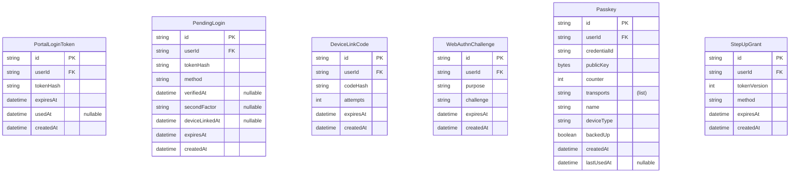
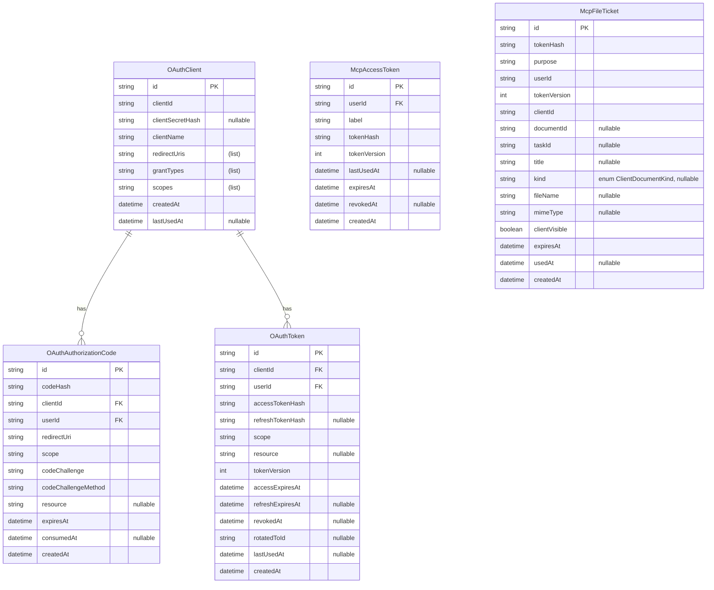
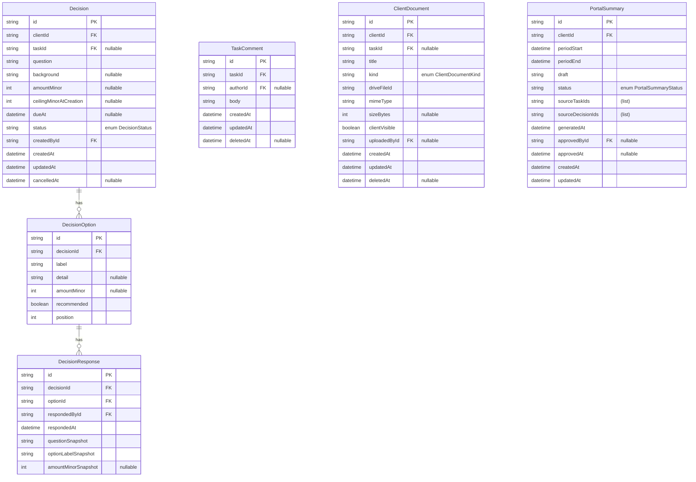
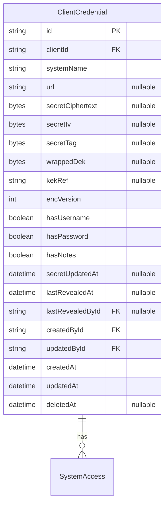
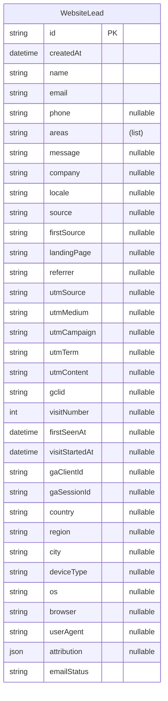
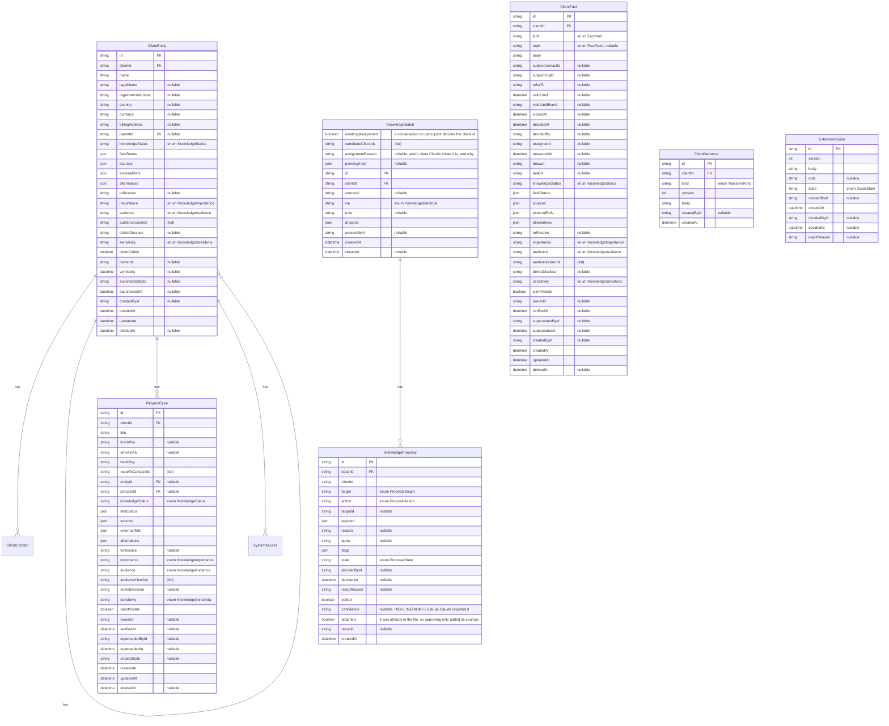
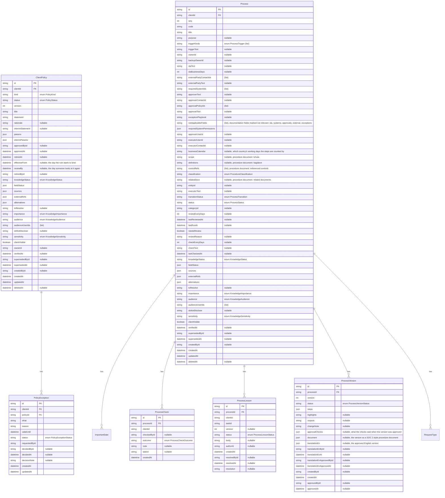
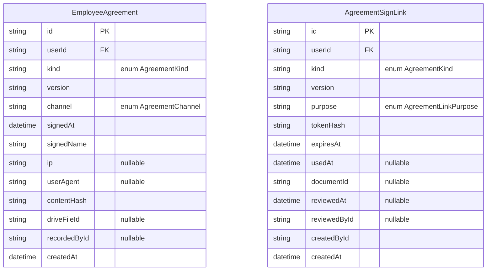

# Schema / ERD

Generated from `prisma/schema.prisma` for spec §26's "תרשים schema/ERD"
deliverable. Grouped by the phase that introduced each model, matching the
`// --- Phase N: ... ---` section comments in `schema.prisma` itself — read
this diagram alongside that file's inline rationale comments, not instead of
them (this document only shows structure and cardinality; the *why* behind
each field/default lives in the schema comments and in `docs/adr/0001`'s
per-phase addenda).

All timestamps are UTC (`timestamptz`). All durations are stored as integer
seconds or minutes, never floats (spec §25). Soft delete (`deletedAt`) is
used throughout instead of hard deletes, except on models that are
append-only/immutable by design (`AuditEvent`, `TimeEntryRevision`,
`ReportRun`), which have no `deletedAt` at all.

## Full entity-relationship diagram

```mermaid
erDiagram
    User ||--o{ PasswordResetToken : "requests"
    User ||--o{ ClientUser : "has membership"
    User ||--o{ UserClientAccess : "is granted"
    User ||--o{ AuditEvent : "acts as actor"
    User ||--o{ TimeEntry : "logs"
    User ||--o{ TimeEntryRevision : "edits as"
    User ||--o{ HourBankAdjustment : "creates"
    User ||--o{ Notification : "receives"

    Client ||--o{ ClientUser : "has portal users"
    Client ||--o{ UserClientAccess : "grants employee access"
    Client ||--o{ Category : "scopes"
    Client ||--o{ AuditEvent : "is subject of"
    Client ||--o{ Task : "owns"
    Client ||--o{ TimeEntry : "is billed for"
    Client ||--o| BillingPolicy : "configures"
    Client ||--o{ HourBank : "owns cycles"
    Client ||--o{ HourBankAdjustment : "receives"
    Client ||--o{ AlertRule : "defines"
    Client ||--o{ ReportSchedule : "subscribes to"

    Category ||--o{ Task : "classifies"
    Category ||--o{ TimeEntry : "classifies"

    Task ||--o{ TimeEntry : "is worked on"

    TimeEntry ||--o{ TimeEntryRevision : "has history"

    HourBank ||--o{ HourBankAdjustment : "is adjusted by"
    HourBank ||--o{ AlertEvent : "triggers (by hourBankId, unenforced FK)"

    AlertRule ||--o{ AlertEvent : "fires"
    AlertEvent ||--o{ EmailDelivery : "sends"

    ReportSchedule ||--o{ ReportRun : "produces"
    ReportRun ||--o{ EmailDelivery : "sends"

    IntegrationConnection ||--o{ ExternalMapping : "maps (by provider)"

    Client ||--o{ ImportantDate : "owns"
    Client ||--o{ HolidayCalendarSubscription : "subscribes to"
    User ||--o{ ImportantDate : "is responsible for"
    Category ||--o{ ImportantDate : "classifies auto-task"
    ImportantDate ||--o{ ReminderRule : "schedules"
    ImportantDate ||--o{ ReminderOccurrence : "emits"
    ReminderRule ||--o{ ReminderOccurrence : "schedules"
    ImportantDate ||--o{ Task : "auto-creates"

    User {
        string id PK
        string email UK
        string username UK
        UserRole role
        UserStatus status
        int tokenVersion
        int failedLoginAttempts
        datetime lockedUntil
        datetime deletedAt
    }

    PasswordResetToken {
        string id PK
        string userId FK
        string tokenHash UK
        datetime expiresAt
        datetime usedAt
    }

    Client {
        string id PK
        string name
        ClientStatus status
        string timezone
        bool portalShowEmployeeNames
        string sourceKeywords "(list) words that name the client in a meeting title"
        string driveFolderId "nullable, the Drive folder its conversations are saved to"
        string conversationsDocId "nullable, the running conversations document"
        datetime deletedAt
    }

    ClientUser {
        string id PK
        string clientId FK
        string userId FK
        ClientUserRole role
    }

    UserClientAccess {
        string id PK
        string userId FK
        string clientId FK
    }

    Category {
        string id PK
        string name
        CategoryVisibility visibility
        string clientId FK "nullable, required when CLIENT"
        bool active
        datetime deletedAt
    }

    AuditEvent {
        string id PK
        string actorId FK "nullable"
        string clientId FK "nullable"
        string action
        string entityType
        string entityId
        json beforeJson
        json afterJson
        datetime createdAt
    }

    Task {
        string id PK
        string clientId FK
        string categoryId FK "nullable"
        string title
        TaskStatus status "OPEN / IN_PROGRESS / PENDING_APPROVAL / DONE / ARCHIVED"
        string source "local or external provider name"
        string externalRef "nullable"
        bool mappingTask "a handover mapping stage: what it learns goes to the client file before it closes"
        datetime deletedAt
    }

    TimeEntry {
        string id PK
        string userId FK
        string clientId FK
        string categoryId FK
        string taskId FK "nullable"
        datetime startAt
        datetime endAt "null while timer running"
        int actualSeconds "server-computed"
        int billableSeconds "server-computed"
        TimeEntrySource source
        bool isEdited
        datetime deletedAt
    }

    TimeEntryRevision {
        string id PK
        string timeEntryId FK
        int version
        string changedById FK "nullable"
        json beforeJson
        json afterJson
        string reason
    }

    BillingPolicy {
        string id PK
        string clientId UK "also FK to Client; one row per client"
        int minimumMinutes
        int incrementMinutes
        RoundingMode roundingMode
        BillingAggregationScope aggregationScope
    }

    HourBank {
        string id PK
        string clientId FK
        datetime cycleStart
        datetime cycleEnd
        int purchasedMinutes
        int rolloverInMinutes
        RolloverMode rolloverMode
        int consumedMinutes "cached, recomputed on read"
        HourBankStatus status
        datetime deletedAt
    }

    HourBankAdjustment {
        string id PK
        string clientId FK
        string hourBankId FK "nullable"
        int minutes "signed"
        string reason
        string createdById FK "nullable"
        datetime effectiveAt
    }

    AlertRule {
        string id PK
        string clientId FK
        AlertThresholdType type
        int thresholdValue
        string_array recipientsAnkora
        string_array recipientsClient
        bool enabled
        bool allowRetrigger
    }

    AlertEvent {
        string id PK
        string ruleId FK
        string hourBankId "plain column, no formal relation"
        datetime triggeredAt
        int value
        datetime resolvedAt "nullable, set once back under threshold"
    }

    EmailDelivery {
        string id PK
        string alertEventId FK "nullable"
        string reportRunId FK "nullable, exactly one of the two set"
        string template
        string_array recipients
        EmailDeliveryStatus status
        int attempts
        string error
    }

    ReportSchedule {
        string id PK
        string clientId FK
        ClientReportType reportType
        ReportFrequency frequency
        string_array recipients
        string timezone
        int dayOfWeek "0-6, WEEKLY only"
        int dayOfMonth "1-28, MONTHLY only"
        int hour
        bool enabled
        datetime lastSentAt
    }

    ReportRun {
        string id PK
        string scheduleId FK
        datetime periodStart
        datetime periodEnd
        json snapshotJson "frozen exact-sent report"
    }

    IntegrationConnection {
        string id PK
        string provider UK
        IntegrationStatus status
        string credentialsRef "opaque pointer, never the secret itself"
        json config
    }

    ExternalMapping {
        string id PK
        string provider FK "references IntegrationConnection.provider"
        string internalEntityType
        string internalEntityId
        string externalEntityType
        string externalEntityId
        json syncMetadata
    }

    Notification {
        string id PK
        string userId FK
        string type "free string, e.g. long_running_timer"
        string title
        string body
        string entityType "nullable"
        string entityId "nullable, dedupe key with type"
        datetime readAt "nullable"
        datetime createdAt
    }

    ImportantDate {
        string id PK
        string clientId FK
        string title
        ImportantDateCategory category
        CalendarType calendarType "GREGORIAN or HEBREW"
        int month
        int day
        RecurrenceType recurrence
        string responsibleUserId FK
        ImportantDateStatus status
        ImportantDateSensitivity sensitivity
        boolean createAutoTask
        string autoTaskCategoryId FK "nullable"
        datetime nextOccurrenceAt "nullable"
        datetime snoozedUntil "nullable"
        boolean expectsReceipt "something is due to reach us from outside on this date"
        string expectedFrom "nullable, who sends it, in words"
        ImportantDateSource source "MANUAL, HOLIDAY or TEMPLATE"
        string holidayKey "nullable, unique per client"
        datetime deletedAt "nullable"
    }

    ReminderRule {
        string id PK
        string importantDateId FK
        int daysBefore
        boolean sendInApp
        boolean sendEmail
        boolean enabled
        boolean createTask
        boolean escalateToManager
        int escalateAfterDays "nullable"
    }

    ReminderOccurrence {
        string id PK
        string importantDateId FK
        string reminderRuleId FK "nullable"
        int occurrenceYear
        datetime occurrenceDate
        ReminderChannel channel "IN_APP or EMAIL"
        datetime scheduledFor
        datetime sentAt "nullable"
        ReminderOccurrenceStatus status
        int attempts
        string idempotencyKey UK
    }

    HolidayCalendarSubscription {
        string id PK
        string clientId FK
        string calendarKey "unique per client, e.g. il_holidays"
        boolean enabled
        int defaultReminderDaysBefore "int[], default [30, 7]"
        string responsibleUserId FK "nullable"
        boolean createTasks
    }
```

## Models grouped by introducing phase

| Phase | Models | Scope (spec §23) |
| --- | --- | --- |
| 0 / 1 | `User`, `PasswordResetToken`, `Client`, `ClientUser`, `UserClientAccess`, `Category`, `AuditEvent` | Auth, roles, users, clients, categories |
| 2 | `Task`, `TimeEntry`, `TimeEntryRevision` | Timer + TimeEntry + manual entry + audit revisions |
| 3 | `BillingPolicy`, `HourBank`, `HourBankAdjustment` | Billing policy + hour bank + live client snapshot |
| 4 | `AlertRule`, `AlertEvent`, `EmailDelivery` | Alerts + email delivery logs |
| 6 | `ReportSchedule`, `ReportRun` | Client portal + scheduled reports (`EmailDelivery.reportRunId` also added this phase) |
| 8 | `IntegrationConnection`, `ExternalMapping` | Integration foundation validation + production rollout |
| 9 | `Notification` (+ `Task.status` added to the Phase 2 `Task` model) | Full spec re-audit gap-fix: Tasks/Profile/Notifications screens, long-timer email/notification, XLSX/PDF export |
| 10 | `ImportantDate`, `ReminderRule`, `ReminderOccurrence`, `HolidayCalendarSubscription` (+ `Task.importantDateId` / `Task.importantDateOccurrenceKey` added to the Phase 2 `Task` model) | Important Dates (מועדים חשובים): per-client dated records, reminder rules, per-occurrence delivery log, and holiday-catalog subscriptions |
| 12 | `User.notifyLongRunningTimerByEmail` (no new tables) | Profile screen's personal email-notification toggle |
| Advance with Claude (10.10.2026) | `TaskPlan` (+ `TaskPlanStatus` enum) | A task's work plan, one row per version: written with Claude through MCP (`save_task_plan`) or edited on the task screen, approved by a person, and optionally copied into the task's steps |

Phases 5, 7 and 11 (internal dashboards/reports/exports; PWA/mobile/
performance/security hardening; the nightly Excel report + JSON backup
email) added no new tables: they built screens, jobs and infrastructure on
top of the models above.

Development stopped being numbered after that. Everything added since the
credentials vault (6.10.2026) is listed in "Entities added after Phase 12"
below, grouped by area rather than by phase.

## Entities added after Phase 12 (credentials vault, client file, processes, portal phase 3)

The diagram above covers Phases 0 to 12 and is kept as written. The
sections below are generated from `prisma/schema.prisma` and cover the
models added since, grouped by the area they belong to rather than by a
phase number: the work stopped being numbered once the client file
("המוח הארגוני") became the main line of development. Relationship lines
show only the one-to-many edges declared inside each group; cross-group
edges, nearly all of which hang off `Client` or `User`, are left out to
keep each diagram readable.

### Client portal access and sign-in

### MCP and OAuth

### Tasks, decisions and portal content

### Credentials vault

### Website leads

### Client file: identity and people

```mermaid
erDiagram
    Organization ||--o{ ClientDomain : "has"
    Organization ||--o{ ClientOrganization : "has"
    Organization ||--o{ Person : "has"
    Person ||--o{ ClientContact : "has"

    Organization {
        string id PK
        string name
        string domains "(list)"
        string website "nullable"
        string notes "nullable"
        datetime createdAt
        datetime updatedAt
        datetime deletedAt "nullable"
    }

    Person {
        string id PK
        string name "nullable"
        string emails "(list)"
        string phones "(list)"
        string organizationId FK "nullable"
        datetime createdAt
        datetime updatedAt
        datetime deletedAt "nullable"
    }

    ClientContact {
        string id PK
        string clientId FK
        string personId FK
        string role "nullable"
        string relationship "enum ContactRelationship"
        string entityId FK "nullable"
        string context "nullable"
        string channelOrder "(list)"
        boolean isPrimary
        boolean isDecisionMaker
        string userId "nullable"
        string clientSideAddress "nullable"
        string knowledgeStatus "enum KnowledgeStatus"
        json fieldStatus
        json sources
        json externalRefs
        json alternatives
        string toResolve "nullable"
        string importance "enum KnowledgeImportance"
        string audience "enum KnowledgeAudience"
        string audienceUserIds "(list)"
        string doNotDisclose "nullable"
        string sensitivity "enum KnowledgeSensitivity"
        boolean clientVisible
        string ownerId "nullable"
        datetime verifiedAt "nullable"
        string supersededById "nullable"
        datetime supersededAt "nullable"
        string createdById "nullable"
        datetime createdAt
        datetime updatedAt
        datetime deletedAt "nullable"
    }

    ClientOrganization {
        string id PK
        string clientId FK
        string organizationId FK
        string role "nullable"
        string relationship "enum ContactRelationship"
        int monthlyCostMinor "nullable"
        string currency "nullable"
        string notes "nullable"
        string knowledgeStatus "enum KnowledgeStatus"
        json fieldStatus
        json sources
        json externalRefs
        json alternatives
        string toResolve "nullable"
        string importance "enum KnowledgeImportance"
        string audience "enum KnowledgeAudience"
        string audienceUserIds "(list)"
        string doNotDisclose "nullable"
        string sensitivity "enum KnowledgeSensitivity"
        boolean clientVisible
        string ownerId "nullable"
        datetime verifiedAt "nullable"
        string supersededById "nullable"
        datetime supersededAt "nullable"
        string createdById "nullable"
        datetime createdAt
        datetime updatedAt
        datetime deletedAt "nullable"
    }

    ClientSource {
        string id PK
        string clientId FK
        int seq
        string code
        string kind "enum SourceKind"
        string weight "enum SourceWeight"
        string title
        datetime occurredAt "nullable"
        string participants "(list)"
        json externalRefs
        string restriction "enum SourceRestriction"
        string notes "nullable"
        string createdById "nullable"
        datetime createdAt
        datetime updatedAt
        datetime deletedAt "nullable"
    }

    ClientDomain {
        string id PK
        string clientId FK
        string domain
        string kind "enum ClientDomainKind"
        string organizationId FK "nullable"
        string notes "nullable"
        string createdById "nullable"
        datetime createdAt
        datetime deletedAt "nullable"
    }

    SystemAccess {
        string id PK
        string clientId FK
        string systemName
        string purpose "nullable"
        string entityId FK "nullable"
        string url "nullable"
        string accountUsed "nullable"
        string ourPermission "enum SystemPermission"
        string accessStatus "enum SystemAccessStatus"
        string blocker "nullable"
        string clientAdmin "nullable"
        string credentialId FK "nullable"
        string billingCycle "enum BillingCycle, nullable"
        int billingCostMinor "nullable"
        string billingCurrency "nullable"
        string cardLast4 "nullable"
        string invoiceTo "nullable"
        string notes "nullable"
        string knowledgeStatus "enum KnowledgeStatus"
        json fieldStatus
        json sources
        json externalRefs
        json alternatives
        string toResolve "nullable"
        string importance "enum KnowledgeImportance"
        string audience "enum KnowledgeAudience"
        string audienceUserIds "(list)"
        string doNotDisclose "nullable"
        string sensitivity "enum KnowledgeSensitivity"
        boolean clientVisible
        string ownerId "nullable"
        datetime verifiedAt "nullable"
        string supersededById "nullable"
        datetime supersededAt "nullable"
        string createdById "nullable"
        datetime createdAt
        datetime updatedAt
        datetime deletedAt "nullable"
    }
```

### Client file: knowledge

### Client file: rules and processes

### Internal suppliers: agreements

### Enums added in the same period

| Enum | Values |
| --- | --- |
| `AgreementChannel` | `APP`, `EMAIL_PDF` |
| `AgreementKind` | `CONFIDENTIALITY`, `DELETION_DECLARATION` |
| `AgreementLinkPurpose` | `APP_SIGN`, `PDF_UPLOAD` |
| `BillingCycle` | `MONTHLY`, `ANNUAL`, `OTHER` |
| `ClientDocumentKind` | `POLICY`, `PROCEDURE`, `CERTIFICATE`, `CONTRACT`, `INVOICE`, `OTHER` |
| `ClientDomainKind` | `CLIENT`, `PARTNER` |
| `ClientKind` | `BUSINESS`, `PRIVATE` |
| `ContactRelationship` | `CLIENT_STAFF`, `PROVIDER`, `ADVISOR`, `INVESTOR`, `SUPPLIER`, `ANKORA` |
| `DatePrecision` | `EXACT`, `APPROXIMATE`, `UNKNOWN` |
| `DecisionStatus` | `OPEN`, `ANSWERED`, `CANCELLED` |
| `EmployeeLifecycleKind` | `ONBOARDING`, `OFFBOARDING` |
| `EntryOrigin` | `APP`, `MCP` |
| `FactKind` | `SCOPE_IN`, `SCOPE_OUT`, `PREFERENCE`, `REQUIREMENT`, `LOCATION`, `FINANCE`, `TEMPORARY`, `ONE_OFF_DECISION`, `QUESTION`, `NOTE` |
| `FactTopic` | `COMMUNICATION`, `REPORTING`, `DOCUMENTS`, `AUTOMATION`, `ADMINS`, `PAYMENTS`, `SUPPLIERS`, `OTHER` |
| `GuideState` | `DRAFT`, `APPROVED`, `REJECTED` |
| `HourBankKind` | `CYCLE`, `PREPAID` |
| `KnowledgeAudience` | `ALL_STAFF`, `ACCOUNT_TEAM`, `RESTRICTED` |
| `KnowledgeBatchVia` | `MCP`, `SCREEN` |
| `KnowledgeImportance` | `NORMAL`, `LOW` |
| `KnowledgeSensitivity` | `NORMAL`, `SENSITIVE` |
| `KnowledgeStatus` | `CONFIRMED`, `UNCERTAIN`, `MISSING`, `SUPERSEDED` |
| `LeadUnit` | `CALENDAR_DAYS`, `BUSINESS_DAYS` |
| `NarrativeKind` | `OVERVIEW`, `BACKGROUND`, `OUR_ROLE` |
| `PolicyExceptionStatus` | `REQUESTED`, `APPROVED`, `REJECTED`, `WITHDRAWN` |
| `PolicyKind` | `DATA_HANDLING`, `DISCLOSURE`, `COMMUNICATION`, `SEPARATION`, `APPROVAL_REQUIRED`, `THRESHOLD`, `REQUIRED_STEP`, `TIMING`, `FORBIDDEN`, `INFO` |
| `PolicyStatus` | `PROPOSED`, `ACTIVE`, `RETIRED` |
| `PortalDigest` | `EVERY_DECISION`, `WEEKLY`, `MONTHLY` |
| `PortalSummaryStatus` | `DRAFT`, `APPROVED`, `DISCARDED` |
| `ProcessCheckOutcome` | `OK`, `ISSUE` |
| `ProcessLessonStatus` | `NOTHING`, `OPEN`, `APPLIED`, `DISMISSED` |
| `ProcessStatus` | `DRAFT`, `ACTIVE`, `PAUSED`, `RETIRED` |
| `ProcessStepMode` | `MANUAL`, `ASSISTED`, `AUTOMATED` |
| `ProcessTransition` | `WITH_CLIENT`, `IN_HANDOVER`, `WITH_ANKORA`, `NOT_PLANNED` |
| `ProcessTrigger` | `SCHEDULED`, `EVENT`, `ON_DEMAND`, `CONTINUOUS` |
| `ProcessVersionStatus` | `DRAFT`, `APPROVED`, `SUPERSEDED` |
| `ProposalAction` | `CREATE`, `SUPERSEDE`, `CONTRADICT` |
| `ProcedureClassification` | `PUBLIC`, `INTERNAL`, `CONFIDENTIAL` |
| `ProposalState` | `PENDING`, `APPROVED`, `REJECTED`, `TASK` |
| `ProposalTarget` | `FACT`, `CONTACT`, `ORGANIZATION`, `SYSTEM`, `REQUEST_TYPE`, `POLICY`, `ENTITY`, `NARRATIVE`, `PROCESS`, `DOMAIN`, `TASK`, `DATE` |
| `RollConvention` | `NONE`, `PREVIOUS_BUSINESS_DAY`, `NEXT_BUSINESS_DAY` |
| `SourceKind` | `TRANSCRIPT`, `CLIENT_DOCUMENT`, `TASK`, `PERSON`, `ANKORA_DOCUMENT`, `EMAIL` |
| `SourceRestriction` | `NONE`, `TOPICS_ONLY` |
| `SourceWeight` | `PRIMARY`, `SECONDARY` |
| `SupplierExperience` | `GOOD`, `OK`, `AVOID` |
| `SystemAccessStatus` | `HAS_ACCESS`, `PENDING`, `NO_ACCESS`, `NOT_NEEDED` |
| `SystemPermission` | `NONE`, `VIEWER`, `USER`, `BILLING`, `ADMIN`, `OWNER` |
| `TaskBlocker` | `CLIENT`, `SUPPLIER`, `INTERNAL`, `OTHER` |
| `TaskPriority` | `LOW`, `NORMAL`, `HIGH`, `URGENT` |

## Notes on relationships not enforced by a Prisma `@relation`

- `AlertEvent.hourBankId` is a plain string column, not a formal foreign key.
  It exists so an alert event records which hour-bank cycle it fired against,
  but no `HourBank` relation/cascade is declared for it in `schema.prisma`.
- `TimeEntry`'s single-active-timer-per-user constraint (spec §18.2) exists
  only as a hand-authored Postgres partial unique index in the Phase 2
  migration SQL (`CREATE UNIQUE INDEX ... WHERE end_at IS NULL`) — Prisma's
  schema DSL cannot express a partial unique index, so it does not appear in
  this diagram's cardinalities and must not be dropped by a future
  Prisma-generated migration. See `schema.prisma`'s Phase 2 header comment.
- `Task.importantDateOccurrenceKey` is a plain string (the occurrence's date
  key), unique together with `importantDateId`. It is what makes the daily
  Important Dates job idempotent: an auto-task is created once per occurrence
  no matter how many times the job runs, without a formal FK to an
  occurrence row.
- `EmailDelivery` has two nullable FKs (`alertEventId`, `reportRunId`); every
  write path sets exactly one, but this is an application-level invariant,
  not a database `CHECK` constraint (Prisma has no portable way to express
  XOR across nullable FKs).
